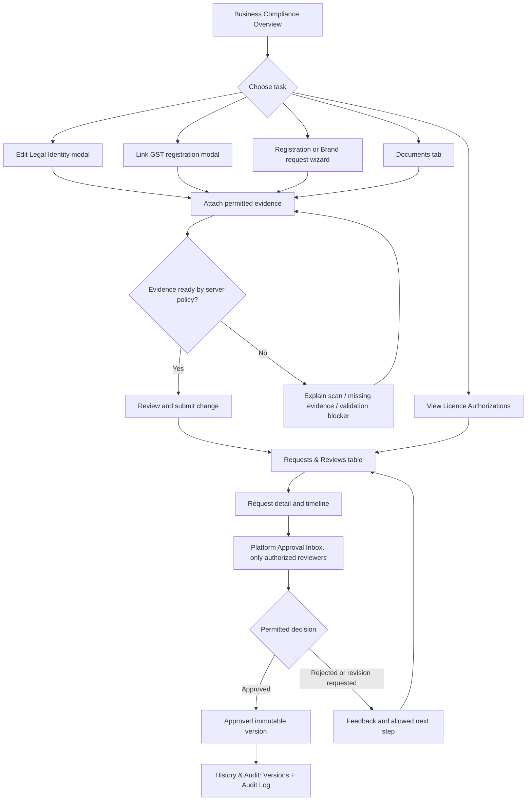

# TRISE India — Business Compliance UI Redesign and Full Functional Verification

**Codex implementation specification | 15 October 2026**

**Primary repository:** `~/wrk/lre/trise-ui`  
**Related repositories, inspect as needed:** `~/wrk/lre/trise-api`, `~/wrk/lre/trise-architecture`  
**Target UI:** Platform Administration → Businesses → selected Business → Compliance / Business Verification  
**Adjacent but distinct UI:** Platform Administration → Compliance Review / Approval Inbox  
**Reference:** user-provided 15-Oct-2026 full-page screenshot of Business Compliance; existing TRISE design mockups and ADRs are visual/domain references, not guaranteed API contracts.

> **Codex mission:** Implement the redesigned interface and verify its real functionality. This is **not** a request to generate another mockup, rename headings only, or add fake frontend behaviors. Read the existing repository and API contracts first. Work in small verified batches and report what is actually implemented, what cannot work without backend support, and the precise test results.

## 0. Non-negotiable principles

1. **Business record vs platform reviewer are separate contexts.** The business-specific compliance page may list and link to its submissions; reviewer assignment and final decisions belong to authorized platform review workflows. Do not expose decisions because a business is selected.
2. **Server state is authoritative** for status, permissions, required fields, available actions, counts, versioning, evidence readiness, and whether GST is mandatory. Never infer an approval/eligibility from a frontend label or mock data.
3. **Immutability:** approved legal and compliance versions are read-only; revisions are proposed through the existing versioned review process.
4. **Document safety:** do not disable/bypass ClamAV or any existing scan/verification/activation gate. `available` as a document lifecycle state does not imply `scan = clean` or `usable as compliance evidence`.
5. **Security boundaries:** enforce platform/business/provider scope on the backend as well as the UI; do not expose cross-tenant IDs, private files, storage keys, unrestricted links, or reviewer capabilities.
6. **API-first:** inspect real routes, OpenAPI schemas, Rails policies/controllers and published requirement catalogues. Do not invent request fields, status enums, endpoints, or backend behavior to make the design appear finished.
7. **Preserve business functionality:** for each legacy action create a mapping to the new location; do not silently drop a feature. If a feature is unsupported by the current API, show a clear disabled state or hide it as appropriate, and log the backend gap.
8. **Keep an accessible UI:** keyboard focus trapping for dialogs, Escape/Cancel, meaningful error messages, screen reader labels, contrast, responsive tables, date formats and unsaved-changes handling.

## 1. Screenshot inspection and current problems to resolve

| Current screenshot section | Observed UX problem | Required outcome |
|---|---|---|
| Overall page | Nearly every feature is stacked vertically into one extremely long page, repeated labels, small text and mismatched controls | Seven logical tabs with only the relevant tab content rendered; compact global context, clear action buttons and no giant forms by default |
| Overview | Too much empty space and technical metadata prominence | Compact business identity and status summary; clear CTA for missing information; readable key-value grid |
| Legal Identity | Always-open large form and supporting evidence checkbox region | Read-only compact status/summary on Overview; `Add / Update legal identity` modal with validated fields, reason and evidence |
| GST Registrations | Long inline tax form; evidence upload disconnected; confusing action button | GST list + `Link GST registration` wizard/modal; GST-specific proof attached in that same workflow, with reliable file browse/upload |
| Verification & Changes | Standalone empty box with unclear purpose and source | Remove as an independent page section; display pending change requests under Requests & Reviews; show approved-vs-proposed comparison inside request details |
| Version History | Empty list without clarity or paging | Dedicated History & Audit tab → Versions subtab; recent 10 first; server-side pagination, filters and reasons why history may be empty |
| Audit | Same as Version History, different semantics not communicated | History & Audit → Audit Log subtab; latest 10, server-backed filters/pagination, actor/action/time/details |
| Supporting Documents | Oversized permanent upload surface; preview/download unclear | Documents tab with concise table, `Upload document` dialog; inline authenticated preview dialog where safely supported |
| Registrations, Brands & Trademarks | Large form always visible; fields appear before a requirement is chosen; missing easy evidence flow | Registration list + `New registration/brand request` schema-driven dialog/wizard; document attachments inside form |
| Licence Authorizations | Narrow cards with truncated provider UUIDs and assignment/decision controls intermingled | Paginated table; friendly provider, licence and scope labels; detail preview with timeline; submission actions separate from platform reviewer decisions |
| Review queue | Tiny filters at page bottom; empty state and reviewer workflow are confusing in business context | Business-scoped Requests & Reviews table with details/timeline; platform-wide actions in Approval Inbox only |

**Important:** Screenshot evidence proves a *layout/UX* issue, not necessarily a missing API or faulty backend. Validate actual functionality before reporting defects.

## 2. Proposed information architecture (IA)

**Page:** `Business Compliance` or `Business Verification` (use one consistent presentation name, keep existing route aliases).  
**Context header (persistent):** Breadcrumb `Platform > Businesses > {BusinessName} > Compliance`; business name; business status (separate from verification status); optional copyable ID in secondary details; one top-level `View business` link. Avoid duplicate platform/operations page titles.

### Seven tabs (desktop); scrollable/overflow tab list or accessible mobile select

1. **Overview** — business verification status and a compact checklist: Legal Identity, GST, Registrations & Brands, Licence Authorizations, Pending Requests. This is primarily read-only and shows next permitted actions.
2. **GST Registrations** — list of canonical GST ownership associations and requests; link/request action modal.
3. **Registrations & Brands** — business registrations, certificates, brands and trademarks; filterable list/table, create/update request modal.
4. **Licence Authorizations** — table of business-owned source licences/provider authorizations and their scope/status; details drawer/modal, permitted request action, timeline.
5. **Documents** — business verification documents and evidence metadata; upload modal, in-app preview, secure download and document state.
6. **Requests & Reviews** — **business-scoped** compliance change/request history, submitted changes and status; searchable/paginated table and request-detail timeline. This absorbs the current `Verification & Changes` and local `Review queue` sections.
7. **History & Audit** — internal subtabs **Approved Versions** and **Audit Log**, each independently paginated with ten records per page.

**Do not add a separate permanent Legal Identity tab:** place a compact Legal Identity summary/action card on Overview and open the editor in a modal. If the business has complicated legal identity history, link to its request details and version history rather than duplicating them.

**Global platform inbox:** retain a separate Platform Administration → Approval Inbox for review assignment and decision, with business/entity scoping shown explicitly. Deep-link from this business page only when the user is authorized for that action.

### Navigation behavior

- Current active tab survives refresh/deep-link using existing routing conventions (route segment or URL query, not arbitrary memory-only state).
- Return from request detail/modal to the same tab, selected row, filters and page.
- For narrow screens use a responsive menu and stack table rows or provide accessible horizontal scrolling; never squeeze 9 columns into a narrow viewport.
- Keep one primary CTA per context; secondary actions visually subordinate.
- No artificial page-height fillers, oversized blank areas, repeated hero banners, or huge sticky card rows on every tab.

## 3. Shared interaction standard

**Open:** button with clear verb (`Edit legal identity`, `Link GST registration`, `New registration request`, `Upload document`, `View authorization`).  
**Edit/create:** moderate modal (typically 640–800px wide; larger only for evidence-rich multi-step flows), max-height within viewport with scrollable body and fixed footer. On small screens present an accessible full-screen dialog.  
**Read/detail:** detail drawer or bounded modal with header, Overview / Evidence / Timeline where appropriate.  
**Footer:** `Cancel` plus one server-valid primary action (e.g. `Submit for review`). `Save draft` only if the API really supports draft creation.  
**Validation:** inline per-field errors, schema-driven required flags and friendly explanations. Explain disabled reasons.  
**States:** initial loading, empty, error/retry, no permission, not applicable, pending, approved, rejected/revision requested *only when backed by the server*, conflict 409/revision mismatch, upload progress and scan pending.  
**Unsaved changes:** warn on close, Escape, route change, and Cancel; avoid unnecessary warnings for read-only details.

### Shared components (reuse instead of duplicating)

`BusinessComplianceHeader`, `StatusSummaryCard`, `ComplianceDataTable`, `ComplianceDetailDrawer`, `FormDialog`, `RequirementDrivenForm`, `EvidenceUploader`, `EvidencePicker`, `DocumentPreviewDialog`, `VersionHistoryTable`, `AuditLogTable`, `RequestTimeline`, `EmptyStateWithAction`, `PermissionNotice`, `StatusBadge`, `CopyableIdentifier`. Use existing equivalent component names where already present. Do not overabstract unrelated domain logic.

## 4. Section-by-section implementation instructions

### 4.1 Overview — compact, purposeful and aligned

**Visible without scrolling unnecessarily:**
- Business name and business type/constitution where available; status and revision placed in a two-column or responsive summary grid.
- Verification overview: Legal Identity, GST, Registrations & Brands, Licence Authorizations, Open Requests. Show a *grounded* state and the **next authorized action** for each.
- `Legal Identity` card: current approved legal name/reference and jurisdiction (only if available), last approved/submitted time if returned, status, `Add / Edit / Request change` button.
- Optional `Recent activity` snippet linking to History; do not duplicate full history.
- If legal identity has never been approved, say `No approved legal identity exists yet` rather than implying a failure or populating mock values.

**Visual rules:** body text typically 14–16px; labels 12–14px; reasonable contrast; max content width; consistent gaps; aligned label/value baselines; no pointless blank white container height; business ID hidden under copy action/metadata expansion.

**Legal Identity modal:**
1. Open current approved values read-only at the top if a version exists.
2. Edit proposed values in structured controls from the backend schema: legal name, constitution, country, registration details, dates, reason, etc. Show fields only if the existing contract supports them.
3. Display available document evidence scoped to this business and any requirement-specific document rules; upload/select inside the dialog if API permits, or link to Documents while preserving draft/form state.
4. Validate all submitted fields and reason before enabling server action; do not hardcode arbitrary legal obligations.
5. Show a review summary, server-defined status and confirmation of where the submission goes.
6. Submit through existing authoritative review API with server version/revision and idempotency when specified. Never directly mutate approved values.
7. On success, show request ID/reference, status and a `View request` link; refresh Overview/Requests and leave approved data unchanged until actual approval.

### 4.2 GST Registrations — association flow and same-context GST proof

**Default tab:** compact table with `GSTIN`, `registration category`, `state/UT`, `effective date`, `ownership/association status`, `last updated` and `View`; only where returned by API. Show `Link GST registration` if the user can initiate it.

**Modal/wizard:**
1. Explain `This links an existing canonical tax registration to the business. It does not edit canonical GST records or choose a subscription billing default.`
2. Search/select existing canonical GST record where supported; otherwise enter only the association fields required by actual API, then let server resolve/verify.
3. Show GSTIN, jurisdiction, category and effective date from canonical data whenever available. Do not let users silently override authoritative tax data.
4. **GST supporting documents must appear in this same GST workflow** with labels such as `GST registration certificate / ownership proof` **only if** those document classifications and requirements are actually supported by the backend. Show optional vs required from policy.
5. Provide an explicit native `Choose file` / `Browse files` button and usable keyboard-accessible file input. Drag/drop may be added **only after testing**; if current drag/drop does not work, remove its claim and use file selection as primary UX.
6. Progress/status for upload, verification, malware scanning, pending readiness and errors. A document cannot be accepted as approved evidence merely because upload succeeded.
7. Display confirmation page and submission reason; validate server-defined GSTIN and jurisdiction constraints; do not make GST mandatory when policy says optional.
8. Show association/request in the table and Requests & Reviews after successful API response.

### 4.3 Verification & Changes — clarify data source; remove duplicate panel

- **Do not retain `Verification & Changes` as another standalone stacked container.**
- Represent each legal/GST/registration change as its native server request in **Requests & Reviews** with request type, target, proposer, submitted date, status and next permitted action.
- When selected, show current approved values vs proposed fields (changed fields highlighted), attachments, reviewer feedback if visible, immutable version reference and timeline.
- If no requests exist, say `No verification change requests found for this business`, with filter state and an authorized CTA; do not synthesize changes from current form inputs.
- Data source must be the authoritative compliance requests API with business scope; validate whether any legacy verification-change API needs an adapter. Document the mapping.

### 4.4 Approved Version History — ten recent records and paginated history

- Put under **History & Audit → Approved Versions**.
- Default sort newest first, **10 rows per page**; show total count/page number only if supported by API; if cursor/keyset pagination is used, implement `Next`/`Previous` without inventing page totals.
- Columns: version, approved date/time (clear timezone), approved by (if visible), changed fields summary, entity/reference, `View details`.
- `View details`: modal with compact approved snapshot (read-only), before/after comparison when supported, source request reference, evidence metadata and a copyable technical ID.
- Preserve immutable data. Do not allow edits, deletions, synthetic backfills or merges into audit versions.
- If history is empty, investigate the actual API and state: first-time business? zero approved versions? wrong scope? response failure? Show the **correct** explanation rather than pretending versions exist. Log missing endpoint/mapping in gap report.

### 4.5 Audit Log — ten recent events; separately paginated

- Put under **History & Audit → Audit Log**, independent paging and filters from Approved Versions.
- Newest 10 by default with server-backed pagination; sortable/filterable by event type, actor and date range **when supported**.
- Columns: action/event, actor, timestamp/timezone, entity, correlation/request reference, result; `View event` for permitted detailed metadata.
- Use an expandable row/detail modal or readable timeline; do not display opaque concatenated UUID text or enormous JSON blocks as the default view.
- Preserve append-only behavior, audit security and redaction. Never leak private secrets, raw payloads or cross-business events.
- Distinguish **domain version history** (approved state snapshots) from **audit history** (user/system events). They are not interchangeable.

### 4.6 Supporting Documents — Documents tab, functional upload and safe inline preview

**List:** filename, classification, linked request/GST (if any), version, size/type, lifecycle state, **scan status**, evidence eligibility state (if API provides), uploaded date, `Preview`, `Download`, and permitted actions. Search, filters and pagination (default 10) against the backend.

**Upload:** `Upload document` button → modal:
1. Choose document purpose/classification (e.g. business verification, GST support, registration evidence) from server-controlled allowed values.
2. Select a file with a **working `Browse files` input**; drag/drop is optional and may not be advertised until browser-tested.
3. Show allowed file types/extensions and max size derived from backend limits rather than assuming any file type is supported.
4. Display file name/size and remove/replace before upload. Show real upload progress/error/retry; do not pretend upload succeeded.
5. Preserve original private file/version metadata, permissions, malware scanning and finalize/activation requirements.
6. On success, refresh list; any `not scanned`/`pending scan` file must be visibly labeled and remain ineligible where scanning is required.
7. Evidence association must point to an authorized document/version, with scope matching the GST/registration/request.

**In-app Preview dialog (no new tab for supported safe previews):**
- Images PNG/JPEG/WebP: bounded responsive ``/secured image viewer via authorized content response; zoom and rotate when useful.
- PDF: use same-origin or authorized streamed PDF through a bounded iframe/PDF viewer with appropriate headers/CSP. Page navigation and fit-to-width where available.
- Word `.docx` and Excel `.xlsx`: browsers generally cannot render these faithfully in an iframe. Use a **trusted server-side generated PDF or sanitized view-only preview** if this capability already exists or is approved for backend implementation. Do **not** use a public third-party Office viewer or expose private document URLs.
- Legacy `.doc`/`.xls`, ODT and other formats: show in-app preview only when backend conversion and MIME allowlists explicitly support them. Otherwise explain `Preview not available for this format` and offer permitted secure download.
- Never serve untrusted office HTML, scripts, macros or spreadsheet formulas as active browser content. Sandbox rendered content and apply strict CSP, MIME/type checks and authorization. Recheck scanning policy for preview/download. Use short-lived scoped transfer and no raw S3 keys/storage URLs.
- `Preview` must open modal and preserve current filter/page, with file metadata, version, close, download (if permitted), loading/error/not-ready states; no unexpected new-tab behavior.
- **API gap handling:** if private preview/conversion does not exist, implement only formats supported today and create a documented backend follow-up. Do not install an insecure public conversion shortcut.

### 4.7 Registrations, Brands & Trademarks — table + schema-driven request form

- Tab default shows a business-scoped list with `Name`, `Type`, `Requirement`, `Registration / trademark reference`, `Jurisdiction`, `Status`, `Expiry / validity` if returned, and `View`.
- User presses `New registration / brand request` → modal or bounded multi-step wizard:
  1. Choose a published business requirement from server catalogue.
  2. Enter only fields relevant to the selected requirement (legal/brand name, registration category, scope, dates, etc. strictly per schema).
  3. Attach documents **inside this flow** with classification and scan/readiness details.
  4. Give reason, review readable summary, save draft only if supported, and submit for review.
- Hide fields until a requirement is chosen; do not show a static 12-field panel for every requirement.
- Avoid two side-by-side multi-page textareas; use responsive grid and consistent alignment, labels and button widths.
- Existing entries open detail modal with supporting evidence, request status, versions and timeline; approved records remain read-only.
- Avoid treating optional requirements as globally mandatory.

### 4.8 Licence Authorizations — data table + details, no inline admin action cards

- Replace horizontal narrow status cards with a paginated table (10 default): `Service provider`, `Source business licence`, `Activities`, `Territory`, `Status`, `Validity`, `Last updated`, `View`.
- Group or distinguish duplicate-looking records by source licence, provider account, request ID, current authorization version and state. Do not collapse distinct valid records merely because the provider names match.
- `View`: detail modal/drawer with readable name, source business, approved source licence, scope constraints, permitted activities/territories, evidence, status, request lineage and timeline.
- `Request authorization` / `Link licence`: show only if existing API/policy supports it and the user is authorized; list **only approved available business-owned licences**; never enlarge activities, territories or validity beyond source licence.
- When none exist, display `No approved business licences available for association` and explain an authorized next step. Do not present a dead-end enabled button.
- **Remove reviewer assignment/decision controls from business-level authorization cards.** Those belong to Platform Approval Inbox, subject to platform role, reviewer assignment, separation of duties and server transitions.
- The business page can show status and a permitted link to the specific platform review detail if the user is authorized for platform review.

### 4.9 Requests & Reviews — business-scoped requests table + readable timeline

- Business page tab `Requests & Reviews` replaces bottom-of-page Review Queue and Verification & Changes.
- Search/filter/sort using backend: request type, status, date range, subject/provider and request reference. Default page size 10; preserve page/filter in URL when feasible.
- Table: Request / Category, target, submitted by, date, status, assigned reviewer (only if permitted), next action, `View`.
- `View` shows selected request detail with `Overview`, `Changes`, `Evidence`, `Timeline` and `Decision` **read-only for ordinary business roles**.
- Diff view: human labels and current approved → proposed changes, including additions/deletions, nested values and nulls; optional read-only raw JSON for authorized advanced inspection.
- Timeline: draft/submission, reviewer assignment (if exposed), evidence events, decisions and approved version information as actually returned by backend; newest/oldest order labeled.
- If the user also has a platform reviewer role, use a visible `Open in Platform Approval Inbox` navigation to perform privileged decisions in the proper context. No silent privilege elevation on a business view.
- Empty state varies by scope and filter: `No requests submitted yet`, `No matching requests`, `Unable to load requests`, `You don't have permission`.

## 5. Full navigation journey (happy path and edge cases)



**Applicability note:** This is an intended UX map, not evidence that every shown transition/API exists today. Only implement transitions exposed by the verified backend contract.

## 6. API / permission / data-source inventory REQUIRED before edits

Create or update `docs/compliance/business-compliance-api-permissions-matrix.md` (or existing equivalent) with:

| Screen/action | Existing frontend component & route | API endpoint + method | Response/request fields | Server policy / allowed role | Revision/idempotency | Test status |
|---|---|---|---|---|---|---|
| Load selected business | inspect | inspect | inspect | inspect | N/A | pending |
| Legal Identity read/propose | inspect | inspect | inspect | inspect | inspect | pending |
| GST canonical search/associate | inspect | inspect | inspect | inspect | inspect | pending |
| Published business requirement catalog | inspect | inspect | inspect | inspect | N/A | pending |
| Registration/brand draft & submission | inspect | inspect | inspect | inspect | inspect | pending |
| Source licence / provider authorization | inspect | inspect | inspect | inspect | inspect | pending |
| Document upload/finalization | inspect | inspect | inspect | inspect | inspect | pending |
| Document preview/download | inspect | inspect | inspect | inspect | inspect | pending |
| Business-scoped request list/details | inspect | inspect | inspect | inspect | N/A | pending |
| Version history | inspect | inspect | inspect | inspect | N/A | pending |
| Audit log | inspect | inspect | inspect | inspect | N/A | pending |
| Global reviewer assignment/decision | inspect | inspect | inspect | platform reviewer role | inspect | pending |

- Prefer existing Rails services/OpenAPI contracts. If an endpoint cannot filter/page, record the gap rather than silently loading unlimited records and client-paginating.
- If a keyset-paginated API is used, use server cursors and do not invent absolute page count.
- Verify request scoping by `business_id`, provider account and platform context, including unauthorized IDs deliberately supplied in a URL.
- Revalidate server response after each mutation and invalidate appropriate cached queries.
- Do not place new permissions exclusively in React; backend authorization is mandatory.
- Update architecture ADR or permission matrix **only when actual behavior/contract changes**; do not rewrite frozen decisions without explicit approval.

## 7. Implementation batches — execute actual changes

### Batch 0 — inspect, matrix and baseline
- Check repository status and avoid overwriting unrelated work; inspect routes/components, package scripts, E2E framework and ADRs.
- Map all ten old sections/actions to seven tabs/modals; document each API, role and missing dependency.
- Run baseline typecheck/lint/tests/build where available; record existing failures accurately.
- Produce an incremental file/task plan with no database changes presumed.

### Batch 1 — IA, overview and reusable UI primitives
- Add seven tabs and clean page header; URL/deep-link navigation; responsive layouts.
- Build consistent empty/loading/error states, tables, dialogs and compact status cards.
- Move Legal Identity to a guided modal with existing API integration and server validation.
- Verify no previous functionality is orphaned.

### Batch 2 — GST associations and registration requests
- GST list and specific association modal; document upload within the same process.
- Published requirements → dynamic registration/brand form modal with request-linked attachments.
- Validate official-looking fields through backend rules, including optional requirements and canonical GST protection.

### Batch 3 — Documents and previews
- Documents tab with working native browse/file input; upload flow, progress, scan status, version-aware associations.
- Preview modal for authorized images/PDF; support Word/Excel only through approved trusted preview service, with honest fallback when absent.
- Test private transfer, MIME/CSP, no raw keys and no bypass of ClamAV.

### Batch 4 — Licence authorizations and request details
- Table, filters, source-licence detail, provider scope, authorization request if supported.
- Move/remove platform-only inline reviewer controls from business page, preserving all authorized functions in Platform Approval Inbox.
- Requests & Reviews table and changes/evidence/timeline details.

### Batch 5 — Versions, audit and pagination
- Two History & Audit subtabs with independent 10-per-page server-backed pagination/cursor logic.
- Implement details, date/actor/event filters only if supported; clear empty, error and permission states.
- Validate chronological and immutable version/audit semantics.

### Batch 6 — Complete functionality + permission tests
- Execute the matrix below, including real backend integration, upload/preview and role boundaries.
- Add missing unit/integration/E2E coverage for navigation, forms, changed-field comparisons, pagination and audit.
- Fix visual alignment at representative desktop/tablet/mobile widths.

### Batch 7 — documentation and delivery review
- Update screen-to-API matrix, UI capability checklist, relevant work plan, relevant ADR/permission docs when justified.
- Document backend gaps separately with endpoint/response proposed changes, security implications and approval requirements.
- Capture screenshots of all seven tabs, modal open states, sample populated/empty/error states, and mobile layouts.
- Report exactly what passed, failed, was blocked, and any risk needing product/architecture decision.

**After each batch:** state files changed, behavior added, backend contract reused, tests executed (actual command & exit status), unresolved issues; continue automatically unless a security-sensitive/architectural decision requires approval. Do not claim a workflow is tested because a button appears enabled.

## 8. Acceptance test matrix — verify real functionality

Test against the real configured development/test backend with authorized role-specific test accounts. Do **not** call these passed until actually exercised. Minimum test coverage:

| ID | Test scenario / expected result |
|---|---|
| NAV-01 | All seven tabs are accessible via click, keyboard and deep link; reload retains selected tab. |
| NAV-02 | Switching tabs preserves appropriate filter/page state; no unwanted stale cross-business data. |
| NAV-03 | Overview is compact and clear at 1440, 1024, 768 and 390px; no overlap, overflow or illegible text. |
| NAV-04 | Labels, primary actions, context, statuses and empty states match the returned data; no fabricated totals. |
| LEG-01 | Legal Identity edit modal opens with server-backed approved read-only snapshot and proposed values. |
| LEG-02 | Required field/reason errors displayed; invalid submit blocked and surfaced server-side. |
| LEG-03 | Valid submission creates a pending request, not an immediate approved overwrite. |
| LEG-04 | Modal Cancel/Escape/close handles unsaved changes and focus restoration. |
| LEG-05 | Stale approved revision conflict shows refresh/review, not silent lost update. |
| GST-01 | GST list shows actual scoped canonical association records and status. |
| GST-02 | GST modal contains relevant GST evidence upload/selection and clear required/optional policy. |
| GST-03 | Browse file opens native file chooser; an actual file can be selected and uploaded. |
| GST-04 | GSTIN/jurisdiction/ownership invalid data is rejected appropriately; canonical record stays unmodified. |
| GST-05 | GST is not marked mandatory unless server policy explicitly requires it. |
| GST-06 | Submitted association appears in correct request/list context after authoritative response. |
| REG-01 | Published requirement selection controls which registration/brand fields render. |
| REG-02 | Attachment flow is inside the registration modal; evidence state & server requirements enforced. |
| REG-03 | New draft saved only if actual draft API exists; submit creates correct scoped request. |
| REG-04 | Existing record details and request history open without unauthorized edit of approved versions. |
| DOC-01 | Document upload button works via native file picker; progress, success and errors accurate. |
| DOC-02 | Document list and metadata have accurate lifecycle and **separate scan state** labels. |
| DOC-03 | Unscanned/infected/ineligible file is blocked from compliance evidence use where scanning required. |
| DOC-04 | Authorized PNG/JPEG/WebP previews open in an in-app modal, not a new browser tab. |
| DOC-05 | Authorized PDF opens in embedded modal when API/security policy allows; close returns to table. |
| DOC-06 | DOCX/XLSX uses an authorized safe rendition when available, otherwise explicit fallback (no insecure external preview). |
| DOC-07 | Unsupported `.doc`/`.xls`/other formats do not falsely promise preview; download only when authorized. |
| DOC-08 | Files from another business/provider return access denied; no raw storage key/url leakage. |
| DOC-09 | File validation, size limit, replacement, abort/retry and MIME handling consistent with API. |
| LIC-01 | Licence table paginates, filters and identifies source business/licence/provider clearly. |
| LIC-02 | Details reveal proper activity/territory scope, evidence, status and timeline. |
| LIC-03 | No approved business licence shows an explanatory empty state and no dead-end unauthorized action. |
| LIC-04 | New association never exceeds approved source scope, and permission is enforced by backend. |
| LIC-05 | Ordinary business user never sees actionable reviewer decision controls. |
| REQ-01 | Verification/changes and review queue merged into correctly business-scoped Requests & Reviews. |
| REQ-02 | Request table server-filters and pages ten at a time; status/type/date/search update result correctly. |
| REQ-03 | Detail shows human-readable current/proposed changes, evidence and timeline. |
| REQ-04 | Authorized reviewer link navigates to separate Platform Approval Inbox; unauthorized users cannot decide. |
| REQ-05 | Revision-requested, rejected, approved and pending scenarios show server-defined next actions only. |
| VER-01 | Approved version history shows newest ten, valid next/previous controls, no invented rows. |
| VER-02 | Version details are immutable and reflect correct scoped business and source request. |
| VER-03 | No approved version correctly displays a first-time/no-data state or error, not a fake version. |
| AUD-01 | Audit log newest ten and filters load authoritative events, with pagination independent of version tab. |
| AUD-02 | Actor/action/time/request references and redacted details are readable and permission-aware. |
| AUD-03 | Audit records are not editable and another business's audit events cannot be accessed. |
| AUTH-01 | Platform, business, provider and restricted users see exactly the permitted navigation/actions. |
| AUTH-02 | Forged IDs/request calls cannot bypass backend tenancy, ownership, scope and reviewer permissions. |
| AUTH-03 | Approvals stay idempotent/version-checked; retries do not create duplicate decisions or requests. |
| UX-01 | All buttons perform intended action; no inert/no-op `Save`, `Browse`, `Preview`, `View`, `Submit`. |
| UX-02 | Empty/forbidden/loading/API error states are distinguishable, actionable and accessible. |
| UX-03 | Modal trapping, labels, tab order, keyboard navigation, contrast and screen-reader feedback meet WCAG 2.2 AA targets where applicable. |
| BUILD-01 | Run actual project typecheck, lint, unit tests, integrations, E2E and production builds; disclose baseline and newly introduced failures separately. |

**Suggested tooling:** Use the repository's *actual* scripts and test runner (do not assume npm/pnpm/yarn command names). If Playwright exists, automate a role-based smoke test. If browser automation is absent, add a reasonable test harness only if compatible with repo policy and provide a precise manual smoke-test checklist. Do not claim end-to-end verification without an accessible running Rails backend and usable test accounts.

## 9. Delivery evidence Codex must provide

Create/update:

1. `docs/compliance/business-compliance-ui-redesign.md` — before/after information architecture, old-to-new action mapping and screenshots.
2. `docs/compliance/business-compliance-api-permissions-matrix.md` — real API and permissions inventory with unsupported gaps.
3. `docs/compliance/business-compliance-functional-qa.md` — the above test matrix marked **PASS / FAIL / BLOCKED / NOT RUN**, links to tests and server/scenario setup.
4. UI capability checklist and project work plan consistent with actual shipped work; any ADR changes proposed (not presumed accepted).

At end of each batch output:

```text
BATCH: [name]
Implemented:
- ...
Files changed:
- ...
APIs actually connected:
- ...
Validation executed:
- command / PASS or FAIL / important result
Acceptance tests:
- IDs and PASS / FAIL / BLOCKED / NOT RUN
Known backend gaps / decisions needed:
- ...
Remaining work:
- ...
```

**Final release gate:** no `P0` permission/security/scan-gate defects; no broken business action previously supported; dialogs usable by mouse and keyboard; independent 10-item history/audit paging; functioning file chooser and safe previews; all applicable acceptance tests marked PASS. Any BLOCKED/NOT RUN case must have an explicit reason and cannot be represented as verified.

## 10. Quick launch prompt for a Codex session

```text
Work in ~/wrk/lre/trise-ui.
Read docs/codex/TRISE_Business_Compliance_UI_Codex_Implementation_Feed.md fully.
Implement the seven-tab Business Compliance refactor and the modal/table/timeline workflows according to that file, in Batches 0–7.
Inspect and reuse current frontend/API/architecture contracts before editing. Validate all ten legacy features remain accessible in their new location.
Preserve platform-vs-business review permissions, server-authoritative workflows, ClamAV evidence gates, immutable versions and business scoping.
Use real upload and inline preview behavior; do not fake Office preview or bypass private storage authorization.
Run actual typecheck/lint/test/build commands, test role- and state-specific journeys against available Rails backend, and report the acceptance matrix with PASS/FAIL/BLOCKED/NOT RUN.
Do not stop after planning; implement batches, reporting each, unless architecture/security blockers require approval.
```

