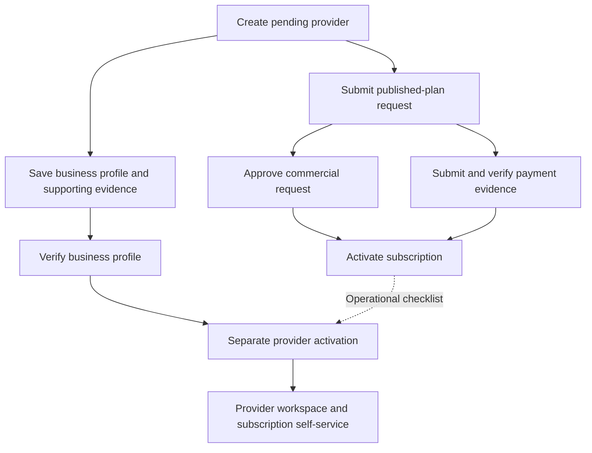

# Platform providers and subscriptions: implementation review and workflow

Reviewed 10 October 2026 against Operations source, Rails controllers/services,
and ADRs 052–060. This is a **code and automated-test review**, not browser or
live-database acceptance. Host readiness remains blocked as recorded in
`browser-readiness-report.md`. No application changes were made in this review.

## Verification evidence

- PASS: current UI suite, 105 tests across 17 files. Relevant cases cover provider
  routes, lifecycle controls, field validation, capability navigation, document
  upload, stale reads, serialized commands/retry keys, history pagination and alerts.
- PASS: eight isolated backend tests, 25 assertions, covering cursor context
  isolation and reminder-preview windows/identity.
- BLOCKED: live API/database integrations and rendered/authenticated browser tests.
  Existing integration tests are source evidence of intended coverage, not passed
  executions here: provider lifecycle/capabilities, platform plans/subscriptions,
  provider self-service and history pagination.
- NOT TESTED: a complete real provider onboarding → subscription → operational
  activation journey, mobile rendering, keyboard interaction and production delivery.

## Implemented feature inventory

| Feature | Implemented UI/API behavior | Limits or acceptance still needed |
| --- | --- | --- |
| Provider directory | Search/filter, cursor navigation, provider detail and loaded-record counts | Browser search/filter/pagination and permissions unverified |
| Provider identity | Create pending provider, edit persisted profile, provider code/details | Creating a provider does not create a login or membership |
| Staged onboarding | Identity, business profile, contacts/offices, documents, plan/approval, final review | Independent saves; not an atomic transaction |
| Business verification | Save/submit revision; verify, reject or request corrections; retain review history | Material edits require renewed review; no section-level amendment/compare workflow |
| Contacts and offices | Provider-scoped persisted contacts and registered/operating offices; validation | Contact != User; office != service coverage. API supports more management operations than onboarding UI exposes |
| Private documents/logo | Upload/finalization, exact-version metadata, authorized preview/download and logo assignment | Storage/scanning policy and real transfer acceptance require separate evidence |
| Onboarding checklist | Actual loaded evidence, admin setup indicator and separate operational status | Loaded counts are not totals; checklist is not an authorization gate |
| Provider lifecycle | Explicit activate, hold, suspend, reactivate, close; reason/revision/idempotency/audit | Backend activation checks business verification, not subscription/admin checklist completion |
| Plan catalogue | Draft/version management, publication controls, immutable published terms, typed limits | Only published versions of active plans are selectable; enforce supported metrics |
| Subscription requests | Platform creates provider request; Provider Admin may request in own active provider context | No automatic approval, payment verification or activation |
| Commercial review | Separate request approval and evidence verification/corrections/rejection | UI reason capture and correction feedback need improvement |
| Subscription activation | Approved request + verified evidence; immutable accepted snapshot and bounded duration | Separate from provider activation; prevents another status-ACTIVE subscription |
| Validity/usage | Server-owned validity, reminder dates, distinct managed-asset and active-agent counters; UI warnings | Warning thresholds do not define eligibility; projection is not reminder delivery |
| Change management | Upgrade, downgrade, renewal, cancellation; approval/evidence/apply and retained predecessor | Future change becomes SCHEDULED; explicit apply is still required when due |
| Billing | Manual invoice with configured tax; evidence review; verified evidence gates mark-paid | UI issues plan-only invoices; add-ons are catalogue-only in current screen |
| History | Provider-scoped platform cursors and independent provider request/change/invoice paging | Large platform histories are eagerly traversed with a 200-page guard; not unlimited retrieval |
| Provider self-service | Own catalogue/subscription/usage/request/change/invoice history | Provider cannot approve, activate, verify payments, mark paid or publish plans |
| Reminders | Milestone projection and read-only preview service | No approved outbound sender, durable delivery receipts or scheduler |

## Clear operating workflow

### New provider: platform operator

1. Sign in normally and enter **Platform → Providers** with explicit platform
   capabilities. Create or select a provider. Save its identity and keep its
   provider ID; do not enter provider context to administer a pending provider.
2. Complete business details, contact records and office records. Save each stage.
   Upload required private documents, finalize them and inspect actual lifecycle
   states. Do not treat a saved contact as an administrator identity.
3. Submit the current business-profile revision for review. Reviewer examines
   that revision and documents, then verifies, rejects or requests corrections.
   For corrections, amend and resubmit using current revisions.
4. Check **Administrator setup**. If missing, arrange membership using an existing
   separately authorized identity/membership process. The reviewed platform
   onboarding screen does not provide a complete create/invite-admin workflow.
5. Open **Plan & approval**. Select an active published plan version and requested
   effective start. Submit a subscription request. This records PENDING_REVIEW;
   it does not activate anything.
6. Open **Platform → Subscriptions → Requests**. Commercial reviewer approves or
   rejects the request. Separately submit payment evidence and have a reviewer
   verify it or request corrections. Approval and payment verification may occur
   in either order, but both are required before subscription activation.
7. With subscription-write authority, **activate the subscription**. Recheck the
   accepted terms, effective start/end, validity and allowance values returned
   by the server. ACTIVE lifecycle status and VALID time window are different.
8. Return to provider **Review & activate**. As an operating procedure, review
   business verification, admin setup and subscription readiness together, then
   execute **Activate provider** with the current lifecycle revision/reason code.
   This is a separate decision: the backend currently requires verified business
   status, not an active subscription or configured administrator.
9. Sign in as the approved Provider Admin and select that ACTIVE provider.
   Check permitted navigation, subscription/usage and history. Refresh and verify
   state persists. Confirm another provider's data is inaccessible through API
   requests as well as UI navigation.

Recommended step ordering above is an operational checklist, not a new backend
prerequisite. Pending providers cannot use ordinary provider-context self-service;
initial setup must be handled through authorized platform actions.

### Existing subscription: renewal or change

1. Open the provider's subscription or **Platform → Subscriptions**. Check the
   accepted version, remaining validity, capacity, current revision and invoices.
2. Request UPGRADE, DOWNGRADE, RENEWAL or CANCELLATION. The server chooses the
   effective boundary: upgrade uses current request time; other kinds use the
   current subscription end, or the duration-derived end if none is stored.
3. Commercial reviewer approves/rejects the change. Upgrade and renewal require
   independently verified commercial evidence before apply. Downgrade/cancellation
   do not use that payment gate in the current controller.
4. Apply with subscription-write authority. If future-effective, result is
   SCHEDULED: put it on a due-work list and explicitly apply again when due.
   No worker was found applying these subscription changes automatically.
5. Successful non-cancellation apply ends the predecessor and creates a successor
   with accepted terms and a new validity window; cancellation ends without a
   successor. Refresh subscription and history; keep historical records.
6. Expiry/reminder milestones do not automatically charge, renew, suspend the
   provider or extend the subscription. Provider restriction needs its own action.

### Billing and collection

1. Billing currently issues against a status-ACTIVE subscription. Select a
   configured effective tax rate and due date. Server calculates plan/add-on
   line totals, tax and a seven-day grace timestamp.
2. Submit invoice-specific transaction evidence; reviewer verifies it. Then a
   subscription writer may mark the invoice PAID. Original subscription-request
   evidence does not automatically pay the invoice.
3. Reconcile the initial payment and subsequent invoice manually to avoid treating
   two evidence resources as two separate collections. No automatic charge,
   proration, refund, credit or renewal is implemented.

### Restrictions and recovery

Hold/suspend/close are explicit provider lifecycle commands with reasons. Review
rejection alone does not restrict an already active provider. Reactivation checks
business verification again and does not recreate revoked memberships. Preserve
history and use approved handling for in-progress work; do not silently transfer
or cancel jobs. Closed-provider lifecycle controls are terminal in the UI.

## Improvement backlog and batch plan

| Priority / batch | Improvement and observed basis | Reviewable acceptance |
| --- | --- | --- |
| P1 / 1 | Explain four independent decisions and display next permissible action/blocker on provider detail | Staff can distinguish verified business, approved request, verified payment, subscription activation and provider activation without inferring authority |
| P1 / 1 | Capture reviewer reasons/correction feedback. Request decisions send fixed generic text; evidence-review calls omit reason; invoice UI exposes verify/reject while API also accepts corrections | User-entered bounded reason persists in audit/review; correction status presents clear resubmission action |
| P1 / 1 | Correct duration-specific invoice wording. UI says “Issue monthly invoice”; server line says “Monthly subscription” while ADR-060 supports six durations | Accurate accepted-duration label; preserve historic snapshots. Review billing-period policy before changing charge calculations |
| P1 / 2 | Add due-change operational queue with explicit apply and current revisions | SCHEDULED never appears as already applied; overdue due-work is visible; conflict cannot silently replace accepted terms |
| P1 / 2 | Complete administrator-setup handoff and delegated manager assignment UI | Existing identity/membership authority remains separate; contacts never grant access; assignment remains provider-bound/revocable. Any new invite contract needs architecture review |
| P2 / 2 | Add invoice add-on selection and quantities; current UI submits `addons: []` | Only published compatible-currency versions; server-calculated totals; valid quantities and retained snapshots |
| P2 / 2 | Provider/status/date filtering and incremental history loading across manager/billing screens | Large datasets do not require fetching every page before useful rendering; incomplete reads stay explicit errors |
| P2 / 2 | Expose contact/location edits/end actions and paginated completeness; API already supports more than current step UI | Preserve revisions/idempotency, correct loaded-count labels, no implied service coverage |
| P2 / 3 | Resolve commercial policy edge cases: no subscription, expired status-ACTIVE record, limits after downgrade, duplicate pending requests and accepted future starts | Approved rules and negative API tests. Current limit enforcer selects status ACTIVE without checking validity and returns when no subscription exists; do not silently introduce access restriction |
| P2 / 3 | Duration/currency consistency and auditability | Evidence forms use accepted currency instead of hardcoded INR where non-INR plans are supported; document actual change boundaries alongside ADR-057/060 |
| Deferred | Outbound reminder delivery — ON HOLD by user instruction | Reviewed recipients/adapter/outbox/worker policy, dedupe/retry/receipt tests; never display SENT from the current preview |
| Acceptance / all | Browser/API role-and-tenant verification | Platform reader/writer/reviewer, Provider Admin and unauthorized staff; stale revision, duplicate click, >100 history, refresh, narrow viewport and real form checks |

Batch 1 is UI clarity with existing APIs. Batch 2 completes existing management
surfaces with contract review where needed. Batch 3 contains policy/backend work;
ADR and authorization/schema decisions require review before implementation.
No speculative worker, billing rule, authentication or tenancy change is included.

## Source anchors

Operations: `apps/operations/src/platform-admin.tsx`, `platform-plans.tsx`,
`platform-provider-subscription.tsx`, `platform-subscriptions.tsx`,
`provider-subscription.tsx`, `provider-readiness.ts`, `provider-lifecycle.ts`.

API: `app/controllers/api/v1/platform_providers_controller.rb`,
`platform_subscriptions_controller.rb`, `platform_subscription_changes_controller.rb`,
`platform_subscription_billing_controller.rb`, `provider_subscriptions_controller.rb`;
`app/services/trise/provider_lifecycle.rb`, `subscription_duration_policy.rb`,
`subscription_limit_enforcer.rb`, `subscription_reminder_preview.rb`.

Authoritative decisions: ADR-053 provider lifecycle; ADR-055 independent approval
and evidence; ADR-057 changes; ADR-058 billing; ADR-059 provider self-service;
ADR-060 duration/reminders. Existing architecture audit documents historical
browser evidence separately; it is not current-session acceptance.

## Priority implementation follow-through — 11 October 2026

The current [priority workplan](../provider-subscription-priority-workplan.md)
supersedes the earlier suggested batch grouping above. Batches 1–3 are implemented;
Batch 4 automated checks pass, while live API/database/browser acceptance remains
blocked. New invoices now use accepted duration wording; evidence currency is
explicit; supported management commands/history controls are exposed. Missing
contracts and commercial rules remain in the [review package](../provider-subscription-policy-review.md).
Outbound reminder delivery remains on hold.
